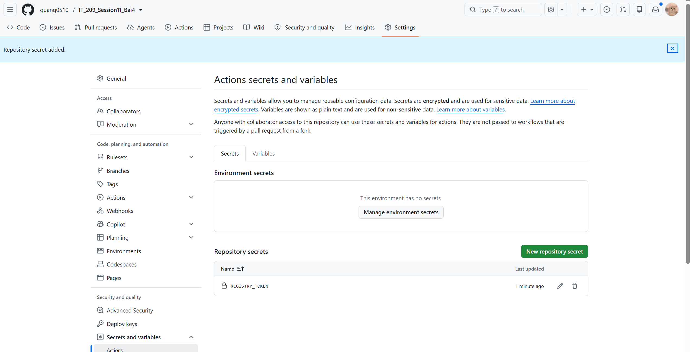
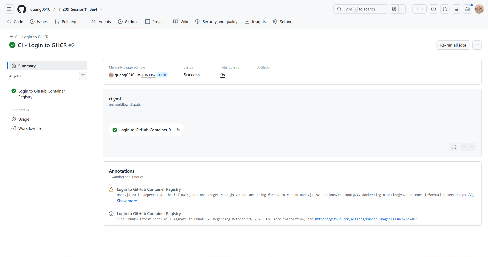

# Bài 4: Khai báo GitHub Secrets và cấu hình Đăng nhập Container Registry

## 1. Mục tiêu bài tập
- Tạo tệp mã hóa an toàn (**Repository Secret**) lưu trữ Token cá nhân trên GitHub.
- Cấu hình bước xác thực đăng nhập tự động vào **GitHub Container Registry (GHCR)** thông qua GitHub Actions.

---

## 2. Kịch bản GitHub Actions (.github/workflows/ci.yml)

Kịch bản được đặt tại [.github/workflows/ci.yml](file:///D:/Desktop/IT209/ss11/Bai4/.github/workflows/ci.yml):

```yaml
name: CI - Login to GHCR

on:
  push:
    branches: [ "main", "master" ]
  pull_request:
    branches: [ "main", "master" ]
  workflow_dispatch:

jobs:
  login:
    name: Login to GitHub Container Registry
    runs-on: ubuntu-latest

    steps:
      - name: Checkout mã nguồn
        uses: actions/checkout@v4

      - name: Đăng nhập vào GitHub Container Registry
        uses: docker/login-action@v3
        with:
          registry: ghcr.io
          username: ${{ github.actor }}
          password: ${{ secrets.REGISTRY_TOKEN }}
```

---

## 3. Kết quả thực hiện & Bằng chứng nộp bài

### 3.1. Ảnh chụp Repository Secrets hiển thị biến REGISTRY_TOKEN (Yêu cầu đề bài)
Đã cấu hình thành công Secret `REGISTRY_TOKEN` trong **Settings -> Secrets and variables -> Actions**:



---

### 3.2. Ảnh chụp kết quả chạy Workflow thành công trên GitHub Actions
Workflow chạy thành công, đăng nhập GHCR hoàn tất:



---

## 4. Đường dẫn cấu trúc nộp bài
- Kịch bản CI chính: `.github/workflows/ci.yml`
- Kịch bản theo đường dẫn gợi ý: `homework/session_11/ex4/ci.yml`
- Ảnh chụp màn hình: `homework/session_11/ex4/repository_secret.png`
